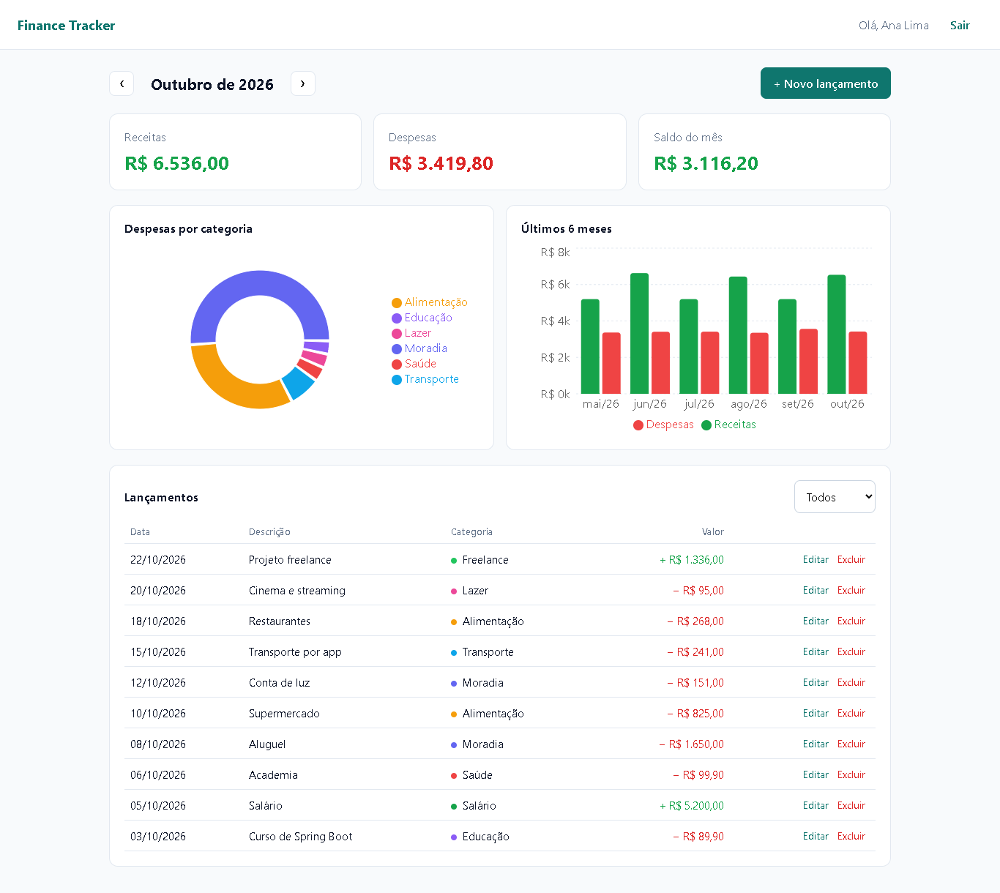
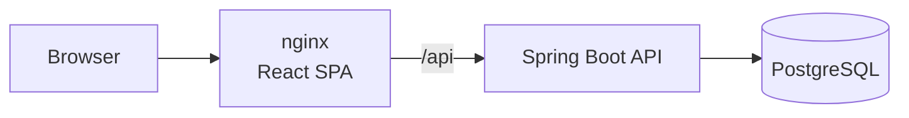
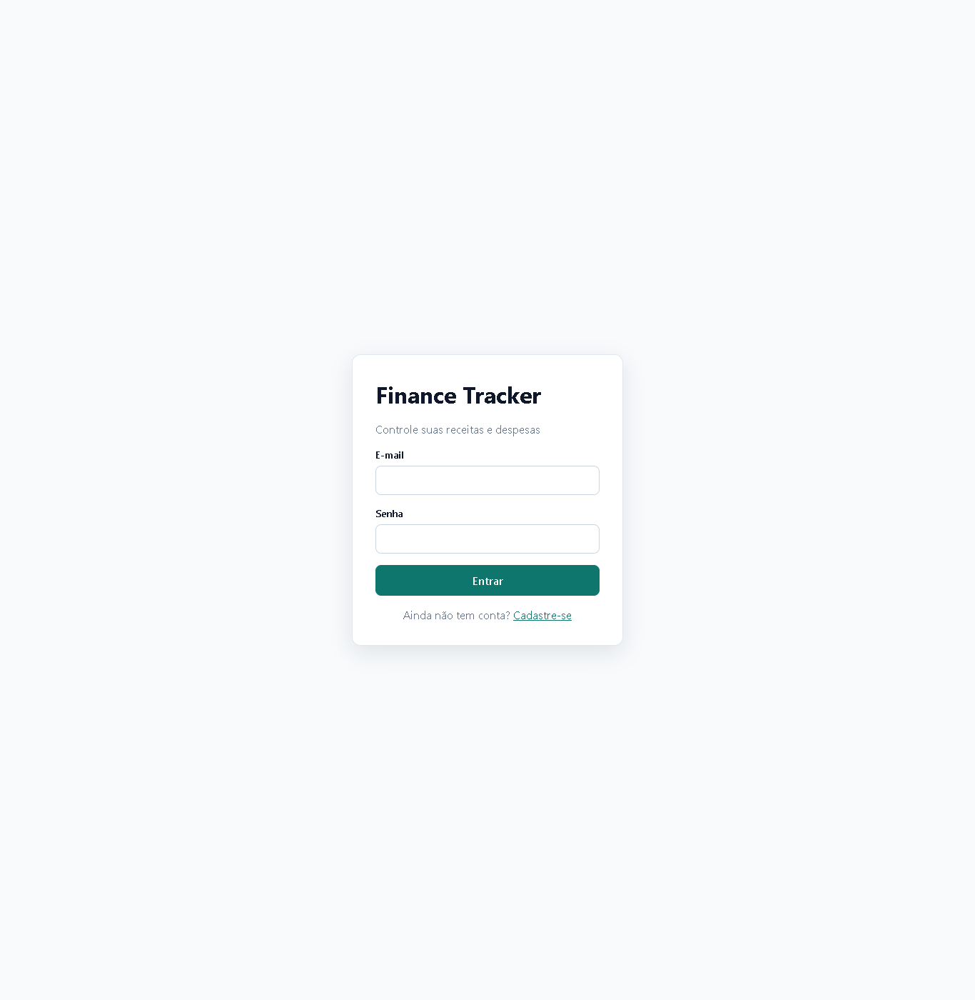

# Finance Tracker · React + Spring Boot


**Full stack** personal finance app: record income and expenses and track your balance, spending by category and monthly trends on a dashboard. Front-end in **React + TypeScript** and a REST API in **Java / Spring Boot**.



## Features

- Sign-up and login with JWT, protected routes and automatic logout when the token expires
- Income and expense entries with category, date and amount
- Month navigation and filtering by type
- Cards showing the month's income, expenses and balance
- Donut chart of expenses by category and bar chart of the last 6 months
- All aggregations run in the database with JPQL (`SUM` + `GROUP BY`), not in memory
- Business rule enforced by the API: the category must match the entry type (e.g. "Salary" only for income)
- Per-user isolation: another account's entries return 404

## Tech stack

| | Technologies |
|---|---|
| **Front-end** | React 19, TypeScript, Vite, React Router, Context API, Recharts, CSS |
| **Back-end** | Java 21, Spring Boot 4.1, Spring Security (OAuth2 Resource Server / JWT), Spring Data JPA, Hibernate, Flyway, springdoc-openapi |
| **Database** | PostgreSQL 17 |
| **Testing** | Vitest + Testing Library (front-end), JUnit 5 + MockMvc + Testcontainers (back-end) |
| **Infrastructure** | Multi-stage Docker, nginx, Docker Compose, GitHub Actions (tests, lint, build and images) |

## Architecture



```
├── backend/src/main/java/com/andresouza/finance
│   ├── transaction/   # Entity, aggregation queries, dashboard service and controller
│   ├── user/          # Sign-up and login
│   ├── security/      # JWT, CORS and Spring Security
│   └── exception/     # Problem Details (RFC 9457)
└── frontend/src
    ├── api/           # HTTP client with token handling and error handling
    ├── auth/          # AuthContext and protected routes
    ├── components/    # Charts and entry form
    ├── pages/         # Login/sign-up and dashboard
    └── utils/         # Currency, date and category formatting
```

## Getting started

### With Docker

```bash
docker compose up --build
```

- App: http://localhost:3000 (create an account on the sign-up screen)
- API / Swagger: http://localhost:8080/swagger-ui.html

### Development mode

```bash
docker compose up -d postgres
cd backend && ./mvnw spring-boot:run      # API on port 8080
cd frontend && npm install && npm run dev # Vite on port 5173, proxying to the API
```

## Tests

```bash
cd backend && ./mvnw verify   # integration tests against real PostgreSQL (Testcontainers)
cd frontend && npm test       # Vitest + Testing Library
```

## Main endpoints

| Method | Route | Description |
|---|---|---|
| POST | `/api/auth/register` | Sign-up |
| POST | `/api/auth/login` | Login (returns a JWT) |
| GET | `/api/dashboard?month=2026-05` | Totals, expenses by category and the last 6 months |
| GET | `/api/transactions?month=&type=&category=` | Entries for the month |
| POST | `/api/transactions` | New entry |
| PUT | `/api/transactions/{id}` | Updates an entry |
| DELETE | `/api/transactions/{id}` | Deletes an entry |

<details>
<summary>Login screen</summary>


</details>

## Author

**André Souza** · Full Stack Java Developer
[LinkedIn](https://www.linkedin.com/in/andre-souza-ti) · [GitHub](https://github.com/AndreSouzaTI)
