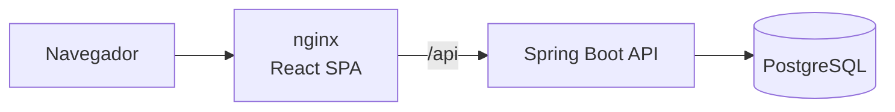

# Finance Tracker · React + Spring Boot


Aplicação **full stack** de controle financeiro pessoal: registre receitas e despesas e acompanhe saldo, gastos por categoria e evolução mensal em um dashboard. Front-end em **React + TypeScript** e API REST em **Java com Spring Boot**.


## Funcionalidades

- Cadastro e login com JWT, rotas protegidas e logout automático quando o token expira
- Lançamentos de receitas e despesas com categoria, data e valor
- Navegação por mês e filtro por tipo
- Cards de receitas, despesas e saldo do mês
- Gráfico de rosca com despesas por categoria e gráfico de barras com os últimos 6 meses
- Todas as agregações são feitas no banco com JPQL (`SUM` + `GROUP BY`), e não em memória
- Regra de negócio validada na API: categoria precisa ser compatível com o tipo (ex.: "Salário" só para receitas)
- Isolamento por usuário: lançamentos de outra conta respondem 404

## Stack

| | Tecnologias |
|---|---|
| **Front-end** | React 19, TypeScript, Vite, React Router, Context API, Recharts, CSS |
| **Back-end** | Java 21, Spring Boot 4.1, Spring Security (OAuth2 Resource Server / JWT), Spring Data JPA, Hibernate, Flyway, springdoc-openapi |
| **Banco** | PostgreSQL 17 |
| **Testes** | Vitest + Testing Library (front), JUnit 5 + MockMvc + Testcontainers (back) |
| **Infra** | Docker multi-stage, nginx, Docker Compose, GitHub Actions (testes, lint, build e imagens) |

## Arquitetura



```
├── backend/src/main/java/com/andresouza/finance
│   ├── transaction/   # Entidade, consultas de agregação, serviço do dashboard e controller
│   ├── user/          # Cadastro e login
│   ├── security/      # JWT, CORS e Spring Security
│   └── exception/     # Problem Details (RFC 9457)
└── frontend/src
    ├── api/           # Cliente HTTP com token e tratamento de erros
    ├── auth/          # AuthContext e rotas protegidas
    ├── components/    # Gráficos e formulário de lançamento
    ├── pages/         # Login/cadastro e dashboard
    └── utils/         # Formatação de moeda, datas e categorias
```

## Como executar

### Com Docker

```bash
docker compose up --build
```

- Aplicação: http://localhost:3000 (crie uma conta na tela de cadastro)
- API / Swagger: http://localhost:8080/swagger-ui.html

### Em modo desenvolvimento

```bash
docker compose up -d postgres
cd backend && ./mvnw spring-boot:run      # API na porta 8080
cd frontend && npm install && npm run dev # Vite na porta 5173, com proxy para a API
```

## Testes

```bash
cd backend && ./mvnw verify   # integração com PostgreSQL real (Testcontainers)
cd frontend && npm test       # Vitest + Testing Library
```

## Endpoints principais

| Método | Rota | Descrição |
|---|---|---|
| POST | `/api/auth/register` | Cadastro |
| POST | `/api/auth/login` | Login (retorna JWT) |
| GET | `/api/dashboard?month=2026-05` | Totais, despesas por categoria e últimos 6 meses |
| GET | `/api/transactions?month=&type=&category=` | Lançamentos do mês |
| POST | `/api/transactions` | Novo lançamento |
| PUT | `/api/transactions/{id}` | Edita lançamento |
| DELETE | `/api/transactions/{id}` | Exclui lançamento |

<details>
<summary>Tela de login</summary>


</details>

## Autor

**André Souza** · Desenvolvedor Java Full Stack
[LinkedIn](https://www.linkedin.com/in/andre-souza-ti) · [GitHub](https://github.com/AndreSouzaTI)
